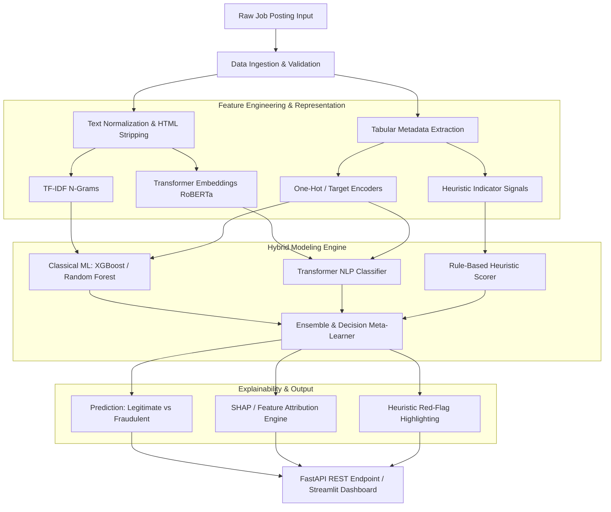

# AI-Powered Fake Job and Recruitment Scam Detection System

**Academic Project**: Final-Year B.Tech Computer Science & Engineering (AI & ML)  
**System Version**: 0.1.0 (Phase 0: Project Foundation)  

---

## 1. Problem Overview

With the rapid expansion of online employment portals and remote work opportunities, fraudulent job postings and employment scams have surged significantly. Malicious entities exploit desperate job seekers by advertising counterfeit vacancies to:
- Steal sensitive personal identifiable information (PII) and banking credentials.
- Demand illicit upfront application/processing or training fees.
- Lure candidates into identity theft rings or money laundering schemes.

Standard rule-based or keyword filtering systems struggle to identify sophisticated scams because modern fraudulent postings closely mimic genuine corporate listings. Detecting recruitment scams requires a multi-faceted machine learning and natural language processing (NLP) framework capable of analyzing unstructured text descriptions alongside structured tabular metadata and domain heuristics.

---

## 2. Project Objective

The primary objective of this project is to develop a complete, reproducible, and explainable AI-powered system that identifies fraudulent job listings with high precision and recall.

Key goals:
1. **Accurate Scam Detection**: Construct high-performance machine learning and transformer-based classifiers tailored for highly imbalanced class distributions.
2. **Hybrid Intelligence**: Combine statistical text embeddings (TF-IDF), contextual embeddings (RoBERTa/DeBERTa), tabular metadata features, and rule-based scam heuristics.
3. **Model Interpretability**: Integrate SHAP (SHapley Additive exPlanations) and rule attribution to provide transparent, human-readable explanations for why a posting is flagged as fraudulent.
4. **End-to-End Application**: Package the system into an accessible web dashboard (Streamlit) and REST API (FastAPI) for interactive real-time verification and batch inference.

---

## 3. Dataset Description

- **Primary Dataset**: Employment Scam Aegean Dataset (EMSCAD) / Kaggle Fake Job Postings Dataset.
- **Volume**: Approximately 17,880 real-world job postings collected between 2012 and 2014.
- **Target Variable**: `fraudulent` (Binary classification: `0 = Legitimate`, `1 = Fraudulent`).
- **Class Imbalance**: Highly skewed (fraudulent postings represent approximately 4–5% of the total dataset, ~866 positive instances).
- **Feature Modalities**:
  - **Textual Fields**: `title`, `company_profile`, `description`, `requirements`, `benefits`.
  - **Categorical Fields**: `employment_type`, `required_experience`, `required_education`, `industry`, `function`.
  - **Binary & Numerical Flags**: `telecommuting`, `has_company_logo`, `has_questions`, `salary_range`.

> **Dataset Integrity Rule**: Raw data files placed in `data/raw/` are treated as strictly immutable. All cleaning and transformations are applied programmatically and saved into `data/processed/`.

---

## 4. Planned System Architecture



---

## 5. Planned Technologies & Libraries

| Category | Libraries / Tools | Purpose |
| :--- | :--- | :--- |
| **Language** | Python 3.10+ | Core programming runtime |
| **Data Processing** | `pandas`, `numpy`, `scipy` | Data manipulation, array computation |
| **Machine Learning** | `scikit-learn`, `imbalanced-learn`, `xgboost`, `lightgbm` | Classifiers, SMOTE, pipeline chaining, model metrics |
| **NLP & Deep Learning** | `nltk`, `spacy`, `transformers`, `torch` | Text preprocessing, tokenization, contextual transformer models |
| **Explainability** | `shap` | Local and global feature importance attributions |
| **Visualization** | `matplotlib`, `seaborn` | Confusion matrices, precision-recall curves, EDA charts |
| **Application & API** | `fastapi`, `uvicorn`, `streamlit`, `pydantic` | Web dashboard and REST API inference services |
| **Persistence & Quality** | `joblib`, `pyyaml`, `pytest` | Pipeline serialization, configuration, unit testing |

---

## 6. Phased Development Roadmap

1. **Phase 0: Project Foundation** *(Current)* — Directory layout, configuration management, logging, virtual environment setup, and verification.
2. **Phase 1: Dataset Acquisition & Exploratory Data Analysis (EDA)** — Data loading, schema verification, class distribution analysis, text length profiling, and correlation mapping.
3. **Phase 2: Data Preprocessing & Feature Engineering** — Text cleaning pipeline, stopword removal, categorical encoding, domain features, and leak-free stratified splitting.
4. **Phase 3: Baseline & Classical Machine Learning Models** — Multinomial Naive Bayes, Logistic Regression, Random Forest, XGBoost, and class imbalance mitigation.
5. **Phase 4: Cross-Validation & Model Benchmarking** — Stratified K-Fold evaluation, PR-AUC / ROC-AUC curves, threshold optimization, and confusion matrix logging.
6. **Phase 5: Advanced Transformer Fine-Tuning** — DistilRoBERTa / DeBERTa sequence classification with metadata fusion.
7. **Phase 6: Heuristic Rules & Model Explainability (SHAP)** — SHAP value computation, word importance visualization, and heuristic red-flag extraction.
8. **Phase 7: End-to-End Pipeline Packaging & Inference Engine** — Unified prediction pipeline with serialized artifacts.
9. **Phase 8: Web Dashboard & REST API** — Interactive Streamlit interface and FastAPI backend.
10. **Phase 9: Comprehensive Testing & Academic Documentation** — Unit test coverage, project report compilation, and presentation assets.

---

## 7. Python Virtual Environment Setup Guide

### Step 1: Create Virtual Environment

#### On Windows (Command Prompt / PowerShell):
```powershell
python -m venv venv
.\venv\Scripts\activate
```

#### On Linux / macOS:
```bash
python3 -m venv venv
source venv/bin/activate
```

### Step 2: Upgrade pip and Install Dependencies
```bash
python -m pip install --upgrade pip
pip install -r requirements.txt
```

### Step 3: Verify Environment Setup
```bash
python verify_environment.py
```

---

## 8. Directory Structure

```text
AI-Powered Job Detection System/
│
├── config/
│   ├── __init__.py
│   ├── config.yaml          # Global hyperparameters, paths, and feature settings
│   └── settings.py          # Type-safe configuration loader
│
├── data/
│   ├── raw/                 # Original immutable dataset files
│   ├── processed/           # Cleaned, tokenized, and transformed data
│   └── external/            # Domain lexicons, suspicious keyword lists
│
├── notebooks/
│   ├── 01_dataset_exploration.ipynb
│   ├── 02_data_cleaning.ipynb
│   ├── 03_baseline_models.ipynb
│   ├── 04_model_comparison.ipynb
│   ├── 05_advanced_models.ipynb
│   └── 06_explainability.ipynb
│
├── src/
│   ├── __init__.py
│   ├── data/                # Ingestion and raw verification
│   ├── preprocessing/       # Cleaning, HTML stripping, text normalization
│   ├── features/            # TF-IDF, embeddings, feature unions
│   ├── models/              # Training scripts, estimators, inference
│   ├── heuristics/          # Rule-based red-flag scanners
│   ├── evaluation/          # Metrics, PR-AUC, confusion matrices
│   ├── explainability/      # SHAP interpretability modules
│   └── utils/               # Centralized logging and helpers
│
├── models/                  # Serialized pipelines and model artifacts (.joblib, .pt)
├── app/                     # FastAPI backend and Streamlit UI
├── tests/                   # Automated unit and integration tests
├── reports/
│   └── figures/             # Evaluation charts, confusion matrices, ROC curves
│
├── .gitignore
├── requirements.txt
├── README.md
├── verify_environment.py    # Environment diagnostic tool
└── main.py                  # Project CLI entry point
```

---

## 9. Important Academic Integrity & Reproducibility Notice

> [!IMPORTANT]
> **Experimental Results Policy**: All metrics, classification accuracies, precision-recall figures, and comparative performance benchmarks documented in this project must originate exclusively from verifiable code execution on real datasets. No synthetic or fabricated metrics will be published or asserted prior to actual model training and evaluation.

---
